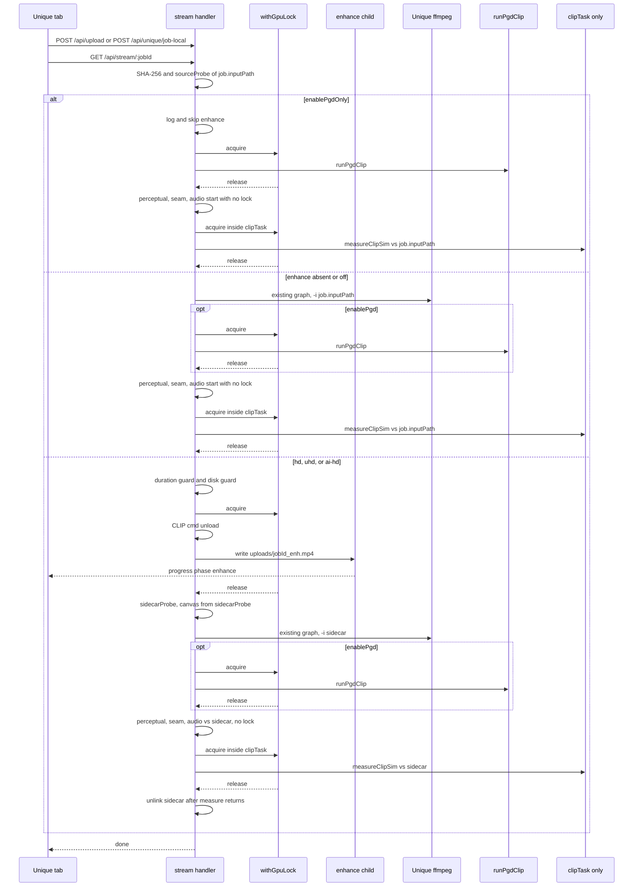

# Unique quality pre-pass (HD / UHD / AI HD)

| | |
|---|---|
| Author | Placeholder — operator review |
| Date | 2026-09-30 |
| Status | Revised |
| Scope | Proposal only. Do not implement until the operator says **thực hiện**. |

## Overview

GhostForge Unique today re-encodes whatever file it was given. It does not have a watchable upscale / denoise / sharpen stage. The operator wants a CapCut-style quality pre-pass with three levels they already use — **HD**, **UHD**, and **AI HD** — that is as fast as this laptop can honestly manage, and that runs **before** the Unique filter graph.

The pre-pass writes one sidecar, `uploads/<jobId>_enh.mp4`, then the existing Unique encode reads that file instead of the original. Unique's filters, PGD hyperparameters, chroma cap, and the removed `geq` stripe stay untouched. The pass is a picture-quality step, not a duplicate-matching feature.

v1 is local only, on the normal Unique path only, default **off**. A benchmark on this 35 W / 4 GB RTX 3050 Laptop picks the engine for each tier. A candidate that misses its wall-time budget is rejected for that tier even if the still looks better. Nothing in this document claims CapCut parity; stills after the benchmark are the quality evidence.

## Background & Motivation

### What the operator asked for

An incoming video should be enhanced before Unique runs. Both the picture and the speed matter. They named three CapCut levels: HD, UHD, and AI HD. The feature is important enough to design against this machine, not against a desktop GPU.

### This machine (measured 2026-09-30)

These are inputs to the design. Re-measure in the benchmark PR; do not replace them with desktop-3050 or 80 W laptop numbers.

| Item | Fact |
|---|---|
| Host | Lenovo 21DA000RUS, Windows 11 Pro 10.0.26200 64-bit |
| CPU | 12th Gen Intel Core i7-12800H, 14 cores / 20 threads, reported max 2400 MHz |
| RAM | 34010619904 bytes (~32 GB) |
| GPU | NVIDIA GeForce RTX 3050 Laptop, 4096 MiB, compute capability 8.6 |
| Power | nvidia-smi power cap **35 W** (`4 W / 35 W` at the sample). Sustained upscale speed is bounded by this cap |
| VRAM at sample | 1453 MiB already in use, no WSL compute process, 66 °C, P8 |
| iGPU | Intel Iris Xe, driver 32.0.101.7085. Do not depend on Quick Sync. Hybrid graphics is a known foot-gun |
| Disk | C: 66.9 GB free / 452 GB. D: 349.4 GB free / 500 GB. Repo is `D:\tool\ghostforge-refactored` (WSL `/mnt/d/tool/ghostforge-refactored`). Models and intermediates stay on D: |
| Python | Windows `python` (the interpreter `pgdPython()` already resolves): torch 2.11.0+cu128, `torch.cuda.is_available()==True`, device name RTX 3050 Laptop, 4096 MiB. No separate PGD venv. `.venv-diar` is diarization only |
| FFmpeg | 9.0.1 essentials (gyan.dev) at `C:\ffmpeg\ffmpeg.exe`. Hwaccels include cuda, qsv, dxva2, d3d11va, d3d12va. Encoders include `h264_nvenc`, `hevc_nvenc`, `av1_nvenc`, `h264_qsv`, `libx264`, `libx265`. Filters include `scale_cuda`, `scale_qsv`, `cas`, `unsharp`, `hqdn3d`, `nlmeans`, `zscale`, `yadif_cuda`. This build has **no** libplacebo, **no** Vulkan scale, and **no** DNN / AI super-resolution filter. `sr_amf` is AMD-only |
| Not installed | `realesrgan-ncnn`, TensorRT, Video2X were not on PATH |
| CapCut | Desktop 9.2.0.3930 is installed. A filename inventory of `Resources\models` found small local ByteNN / effect models (largest around 12 MB: matting, face, interpolation `lens_vfi_v1.0.model` ~10 MB, tiny `nn_denoise.bytenn`). No large super-resolution checkpoint was in that tree. Those files were not opened and must not be copied |

Public 2026 descriptions of CapCut desktop say Video → Basic → Enhance quality, with levels HD, UHD, and 4K on some builds (HD / UHD on others). This operator's labels are HD, UHD, and AI HD. GhostForge uses those three names. This document does not claim to know CapCut's or ByteDance's private architecture, and it does not propose extracting their weights.

### What Unique actually does today

Verified in the current source. Where this prompt and the code disagree, the code is what the design follows.

- Entry: `processOneFile` / `startProcessing` in `src/ghostforge-app.tsx` post either `POST /api/upload` (multer, 500 MB) or `POST /api/unique/job-local` (disk path, `keepInput: true`). Both store `settings` on the job. `GET /api/stream/:jobId` is the Unique handler in `ghostforge-server.js`. `uniqueStreamBlock` in `server/youtube-import.js` rejects edit, reframe, and youtube-import jobs.
- The handler hashes `job.inputPath`, probes with `probeMedia`, then either takes the PGD-only branch or builds a CPU filter graph (`scale` / `crop` / `hue` / `eq` / `noise` / `unsharp`, optional rotate) and encodes with `encoderAttempts` → `resolveEncoder` / `canOpenEncoder`. GPU in that graph is the NVENC (or QSV) encoder, not the filters.
- Default parallelism is 2. `parallelJobs` in the Unique tab is `1` only when `localStorage['gf_parallel'] === '1'`; otherwise it is `2`. `startProcessing` runs that many workers.
- PGD is `runPgdClip` → `pgd_clip.py`. Before it, `prepareClipWorkerForPgd` asks the warm CLIP helper (`clip_sim_server.py`) for free VRAM and unloads weights when free &lt; `CLIP_PGD_VRAM_HEADROOM_MB` (2000). There is **no** lock between two jobs. `CURRENT_STATE.md` does not record a measured dual-PGD OOM. It records that the helper and PGD's own CLIP both fit when free VRAM was 2580/4096, and that the in-loop OOM batch-halve in `pgd_clip.py` was never provoked on this machine. An older comment inside `runPgdClip` ("two at once does not fit comfortably") was superseded in that same function by `prepareClipWorkerForPgd`. Two full PGD jobs at `parallelJobs === 2` are an unmeasured risk on a 4 GB card, which is why the mutex is a precaution, not a citation of a logged crash.
- `measureUniqueOutput({ inputPath, outputPath, outputDurationSec, speed })` compares the Unique **output** to the path it was given. Both call sites pass `job.inputPath` — the operator's file, not a sidecar (normal path and PGD-only path). `measureClipSim` is not a sibling call. It is `clipTask` inside that function, in a `Promise.all` with perceptual, seam, and audio. `samplePairTimes` (`server/perceptual-hash.js`) treats `outputDurationSec` as the **output** timeline and sets `sourceT = outputT * speed`. The normal call passes `(probeInfo.durationSec || 0) / speed`, i.e. the pre-`setpts` duration divided once. The same `probeInfo` object also fills every `original*` done field and the Ken Burns fallback `Math.max(Number(probeInfo.durationSec) || 8, 0.75)`. `uniqueMeasurementStats` copies the four results into `perceptualDistance`, `clipSimOut`, seam, and audio fields. The compare JPEGs are different: `proc` is a frame of the output, and `diff` is that frame blended with its own blur. They are not a source-versus-output hash. The UI does not show `cmp_orig`.
- Stage timers are `stagePrepMs`, `stageEncodeMs`, `stagePgdMs`, `stageMetadataMs`, `stageMeasureMs`. There is no enhance stage.
- Sidecars swept by `DELETE /api/job/:jobId` are `_enc.mp4`, `_pgd.mp4`, `_sized.mp4`, `_cmp_orig.jpg`, `_cmp_proc.jpg`, `_cmp_diff.jpg`, `_clip.json`. There is no `_enh.mp4`.
- Cancel: `abortJob` → `planChildKill`. Unique does not set `killTree`, so cancel is one `SIGKILL` to `job.ffmpeg`. YouTube import sets `killTree`, and `killProcessTree` uses `taskkill /T /F` on Windows. `pgd_clip.py` already spawns ffmpeg grandchildren; this design does not rewrite that. The new enhance child will.
- Colour: `pgd_clip.py` documents the measured failure. Raw `yuv420p` has no tags. Without `-color_range tv -colorspace bt709 -color_primaries bt709 -color_trc bt709` on the raw input **and** the output, a later convert shifted colour (about 34.5 dB PSNR / 2.8% luma versus 49.5 dB / 0.1% with tags). `probeMedia` does **not** return colour as structured fields. It does return `raw`, the ffmpeg stderr, which is where a `yuv420p(tv, bt709)` tag appears. v1 parses that string. It does not add fields to `probeMedia`.
- PGD failure is **not** fail-closed. Around the normal-path `runPgdClip` call, a PGD error is logged and the Unique file is kept. Enhance must not copy that pattern.
- Presets: `applyPreset` writes strength, rotate, adversarial, audio, canvas, feather, and PGD. It does **not** run on mount (a mount re-apply used to wipe a stored "Cực mạnh"). `pgdOnlyActive` (`enablePgd && enablePgdOnly`) hides Unique-only controls and the banner says why.
- `encoderAttempts` prefers NVIDIA constqp **qp 23** on the p6 and p4 attempts, then a `preset fast` attempt and a bare `h264_nvenc` attempt that **omit** qp. Do not describe the whole list as qp 23, and do not edit it. PGD's write-out uses qp 18 when NVENC opens (`pgdEncoderArgs`). A pre-pass that is softer than the next encode wastes its time; the sidecar is specified at qp 16 below.

### Pain

A 720p or soft 1080p social clip enters Unique at that resolution. Unique then zooms, grades, and encodes. There is no supported way to hand Unique a sharper, larger picture first. Doing that inside the Unique graph would put a GPU super-resolution filter on a CPU graph, make it impossible to delete, and mix the enhance delta into `perceptualDistance`.

## Goals & Non-Goals

### Goals

- Three operator-facing levels, one stored field, default off: `hd`, `uhd`, `ai-hd`.
- Pre-pass on the normal Unique path only, finished and VRAM-released before PGD.
- Speed budgets enforced on **this** 35 W / 4 GB GPU, sustained, not cold.
- Fail the job if a selected level cannot be produced. No silent fallback to the original.
- One in-process GPU lock so enhance, PGD, and the CLIP measure cannot overlap on this card. The lock also serializes PGD and CLIP measure when enhance is off. That timing change is intentional. Edit and Reframe stay outside it in v1.
- Keep uniqueness numbers honest: hashes and `clipSimOut` compare the Unique render to the file Unique encoded.
- Cancel kills the enhance process, including grandchildren, and deletes a partial sidecar.

### Non-goals

- Not Edit, not Auto Reframe, not the YouTube tab, not PGD-only. PGD-only hides the control. Those other pipelines may still open NVENC in the same process; v1 does not take the GPU lock from them (accepted residual risk, not a silent widening).
- Not a cloud upscale API. Not CapCut / ByteDance weight reuse or extraction.
- Not TensorRT, BasicVSR++, RVRT, CodeFormer, GFPGAN, diffusion video upscalers, or Topaz in v1.
- Not a 4K / 3840 output tier in v1.
- Not an "enhance only, skip Unique" mode in v1 (open question).
- Do not retune Unique filter coefficients, PGD eps/steps/EOT, chroma grain, or reintroduce `geq` stripes. Do not change encoder selection for the Unique encode or the PGD write-out.
- Do not merge SR into the Unique `-vf` graph in v1.
- No new listening port, no new API key, no Gemini / Vertex call.

## Proposed Design

### Where it sits



The handler never wraps `measureUniqueOutput` in `withGpuLock`. Only `clipTask`, inside that function, takes the lock. The other three tasks start immediately. `withGpuLock` is not reentrant: `prev.then(fn)` waits on a tail that the outer call releases only in `finally`, so a second entry on the same call stack deadlocks. Do not hold the lock across `measureUniqueOutput`, and do not take it both around that function and inside `clipTask`.

`job.inputPath` is never replaced. The success path already unlinks it (and `keepInput` only stops `DELETE`, not that unlink — existing YouTube behaviour, left as-is). A local `encodeInput` is either the sidecar or `job.inputPath`. The filter graph's `-i`, the geometry used to build that graph, and `measureUniqueOutput`'s `inputPath` all use `encodeInput`. Those three stay in one change. The panel row that explains the numbers can land later. The control must not ship while the reference is still `job.inputPath`.

### Reorder inside the Unique handler

Today the handler logs canvas geometry and only then returns on `pgdOnly` (`enablePgdOnly === 'true'`). Enhance has to be skipped entirely on that branch, and the normal path has to plan the canvas from the sidecar.

Implemented shape:

1. Hash and `probeMedia(job.inputPath)` stay first. Keep that result as `sourceProbe`. It is the only object that fills `originalWidth`, `originalHeight`, `originalDuration`, `originalCodec`, `originalFps`, and the Ken Burns fallback `Math.max(Number(sourceProbe.durationSec) || 8, 0.75)`. Enhance must not use that 8-second fallback as its own duration. `tProbe` still closes prep. Prep does **not** include enhance. When enhance does not run, set `tEnhance = tProbe` so `stageEncodeMs` stays `tEncode - tProbe`.
2. If `pgdOnly`: if `enhanceQuality` is not off, log `[SYS] Nâng chất lượng bỏ qua: PGD-only đang bật, pre-pass không chạy.` and do not start the GPU. Then the existing PGD-only body. `runPgdClip` is inside `withGpuLock`. `measureUniqueOutput` is not. Its `inputPath` stays `job.inputPath` and its `outputDurationSec` stays `Number(sourceProbe.durationSec) || 0` with `speed: 1`. `clipTask` takes the lock; perceptual, seam, and audio do not.
3. On the normal path, before the `args` array that currently hard-codes `-i`, `job.inputPath`: `normalizeEnhanceLevel`. Absent or empty → `off`, no log. Any other unrecognized token → fail the job and name the token (see Settings wire). Do not coerce `4k` or `ai_hd` to off.
4. If a level is set: duration guard and disk guard **before** the lock. Then `withGpuLock`: unload CLIP, spawn the enhance child, wait, and release before any later await. On any failure or cancel, unlink the partial sidecar and `sendEvent('error', ...)`. Do not start Unique.
5. If the sidecar exists, `probeMedia` it into a **second** object, `sidecarProbe`. Recompute `srcW`, `srcH`, `srcEvenW`, `srcEvenH`, `outW`, `outH`, `convertCanvas`, and `alreadyTarget` from `sidecarProbe` only. Do not assign over `sourceProbe`. The first geometry log must describe the file Unique will encode. Moving the canvas block to after enhance is the small handler edit. PGD-only returns before that block, so it stops logging a canvas it never uses. That is a log-order change only; no PGD-only filter change.
6. The rest of the graph, `encoderAttempts`, optional PGD, and the metadata remux stay. Both `runPgdClip` call sites are inside `withGpuLock` (the PGD-only site and the normal-path site). The measure **call** passes `inputPath: encodeInput` in this same change, not in a later PR. Inside `measureUniqueOutput`, only `clipTask` takes the lock.

Why two probes: replacing `probeInfo` would make the result panel's "original" size the sidecar and would move `ĐỔI CỠ` for a reason other than the delivered file. Why re-probe at all: `outW` / `outH` and the crop window are computed from the probed width and height. If Unique kept the original 1080×1920 numbers and only swapped `-i` to a 1440×2560 sidecar, the crop would throw the extra pixels away. TikTok canvas (`enableTikTokCanvas === 'true'`) still forces 1080×1920 afterwards. Log when that shrinks an enhanced frame: the pre-pass still feeds a cleaner source into the pad, but the delivered file is 1080×1920. Do not block the combination.

The lock changes queue timing whenever `parallelJobs` is 2, including jobs that never send `enhanceQuality`. Two PGD passes, and two CLIP measures, no longer overlap. The filter graph string, `encoderAttempts`, and the meaning of the perceptual done fields (still "render versus the file Unique encoded") do not change on the enhance-off path. Do not call that path behavior-neutral.

### Output size rules

Pure function, no I/O, in `server/enhance-plan.js`. Do **not** import `evenDim` from `ghostforge-server.js`; that file is the server entry point. Duplicate the one-liner locally: `Math.round`, then round down to a multiple of 2, minimum 2. Aspect is `width/height` of the source. Round to nearest pixel, then that even step. A one-pixel even correction is allowed; a pixel-count increase is not, except where the rule below says to scale up.

FFmpeg-only tiers stay multiple-of-2. Any tier whose shipped engine is the ×4 network then rounds **each axis down** to a multiple of 4 (minimum 4) after the even correction, still without increasing pixel count, and the handler logs a one- or two-pixel trim. `1918 % 4 === 2`, so there is no integer input whose ×4 output is 1080×1918. Candidate A and the HD challenger set model input to `planned output / 4` and require that quotient to be an integer. Candidate B may lanczos-down after ×4, but the canvas it is asked to land on is still the multiple-of-4 size, so one geometry function serves every AI tier.

| Level | Geometry | Engine allowed in v1 | Sustained wall-time budget |
|---|---|---|---|
| `off` | Unique sees the original file. No sidecar | none | n/a |
| `hd` | If `min(w,h) < 1080`, scale so the short side is 1080 and the long side follows aspect. If the short side is already ≥ 1080, do **not** increase pixel count; denoise / sharpen at the even source size | FFmpeg `scale_cuda` (fallback `scale`) + `cas` + light `hqdn3d`, NVENC. Compact AI is only a challenger | ≤ **0.5×** source duration |
| `uhd` | Long-side target **2560**, even dimensions, **never more than 2×** in one pass. If the source long side is already ≥ 2560, do not increase pixel count. Do not target 3840 | Compact `realesr-general-x4v3` if it meets the budget; otherwise the same FFmpeg chain at this geometry, if **that** meets the budget. If neither does, the level is not offered | ≤ **1.0×** source duration |
| `ai-hd` | **Same pixels as UHD.** The extra time is quality, not a larger frame. 4K exists only in a later tier if a future benchmark beats the UHD budget at 3840 on this GPU | Same candidate family as UHD, with the heavier AI setting below. If no candidate both meets 3× and is visibly stronger than the UHD winner on the benchmark stills, hide the level | ≤ **3.0×** source duration |

Worked sizes (portrait phone video is the common case):

| Source | HD | UHD and AI HD |
|---|---|---|
| 1080×1920 | 1080×1920, no pixel increase | 1440×2560 (scale 1.333×) |
| 720×1280 | 1080×1920 (1.5×) | 1440×2560 (exactly 2×, which also hits 2560) |
| 1080×1440 (long side 1440) | 1080×1440, short side already 1080 | 1920×2560 (1.778×) |
| 640×360 | 1920×1080 (short side 360 → 1080, 3×; HD has no 2× cap) | 1280×720 (2× cap; long side stops at 1280, not 2560). Log the cap |
| 1440×2560 or any long side ≥ 2560 | HD rule only (no increase if short side ≥ 1080) | even source size, no increase |
| Odd 1080×1919, short side already ≥ 1080 | FFmpeg: 1080×1918 (multiple of 2, no pixel increase). ×4 net: 1080×1916, log the 2 px trim | Same rule on the UHD scale, then multiple-of-4 only when the shipped engine is the ×4 net |

`ai-hd` calls the same geometry function as `uhd`. The tier table, not the size function, carries engine, denoise, and budget.

### Duration guard

`ENHANCE_SLOW_MAX_SEC = 1200` (20 minutes).

- Probed duration `> 1200` and level is `uhd` or `ai-hd`: do not take the GPU lock. Fail the job. Log and UI error, Vietnamese, including the probed seconds and the sentence that HD is still allowed. Example: `Nâng chất lượng UHD bị từ chối: video dài 2400s, trần v1 là 20 phút. Chọn HD hoặc Tắt.`
- Same duration and level `hd`: run HD. Log that the slow tiers were not considered.
- Duration missing, `0`, or not finite, and any level other than off: fail closed (`không đọc được thời lượng, không chạy nâng chất lượng`). Unique today substitutes 8 seconds when the probe duration is empty (`Math.max(duration, 0.75)`). Enhance must not inherit that guess. YouTube import allows 7200 s and 8 GiB; a 35 W AI pass on that file is hours of heat and a multi-gigabyte sidecar.

The 20 minute ceiling is a v1 product limit, not a claim about the operator's real clip lengths. Whether it should be lower is an open question.

### Speed budget and the acceptance clip

Budgets are sustained wall time divided by source duration, after the GPU has been busy long enough to leave the 35 W boost. Report a cold number and a sustained number. **The sustained number is the gate.** These budgets are targets, not measurements. The benchmark PR is what measures them. A candidate that misses is rejected for that tier.

| | Acceptance clip | Sustained limit |
|---|---|---|
| Clip | 10 s, 1080×1920, 30 fps, H.264 | — |
| HD | wall ≤ 5 s | 0.5× |
| UHD | wall ≤ 10 s | 1.0× |
| AI HD | wall ≤ 30 s | 3.0× |

How to get a sustained sample: run the same graph for 60 s (or three back-to-back passes of the 10 s clip) and time the last pass. Sample `nvidia-smi` power and memory during it. Idle on this card was P8 at 4 W / 35 W; a cold first second is not the product.

After an engine is chosen, a later user job that runs hot and misses the budget **still finishes**. `enhanceBudgetMet: false` is logged and stored. Thermal throttle is not a crash. The fail-closed rule is for a broken enhance (crash, OOM after tile fallback, missing model, encoder will not open, guard rejection, empty output), not for a 10% overrun.

### Engines

#### HD baseline — FFmpeg, no new dependency

Allowed to win HD. Starting graph, numbers for the benchmark to move, not Unique's graph:

1. Try CUDA scale when a scale is required or when `scale_cuda` opens at all. Decode with `-hwaccel cuda -hwaccel_output_format cuda` only on this attempt. `scale_cuda` to the planned even size, `hwdownload,format=nv12`, then CPU `cas=0.5`, then light `hqdn3d=1.5:1.5:4:3`. `cas` and `hqdn3d` are not CUDA filters in this build, so the download is required.
2. If that attempt fails (hybrid-GPU failure included), one retry with CPU `scale=w:h:flags=lanczos` and the same `cas` / `hqdn3d`. No Quick Sync, no `scale_qsv`.
3. Encode NVENC `h264_nvenc -preset p5 -rc constqp -qp 16 -pix_fmt nv12`, audio `-c:a copy`, `-movflags +faststart`.
4. Tags on the output, always: `-color_range tv -colorspace bt709 -color_primaries bt709 -color_trc bt709`. Parse matrix and range from `sourceProbe.raw` only (the ffmpeg stderr already stored by `probeMedia`). If that string shows `bt601` or `bt2020`, pass that matrix through instead of forcing bt709, and still write **some** explicit tags. If `raw` has no matrix, assume bt709/tv and log the assumption. Do not add a colour field to `probeMedia`, and do not spawn a second probe just to read tags. This is the PGD colour lesson applied to a real encode, not a raw pipe.
5. If NVENC `canOpenEncoder('h264_nvenc', ['-preset','p5','-rc','constqp','-qp','16'])` fails, one `libx264 -preset veryfast -crf 16` retry. If that misses the HD budget, this engine is rejected for HD by the benchmark. If both encoders fail at runtime later, the job fails.

`cas=0.5` and `hqdn3d=1.5:1.5:4:3` are enhance-graph constants in `server/enhance.js`. They are not edits to the Unique chain.

#### Compact AI — UHD, AI HD, and an HD challenger

Model: **realesr-general-x4v3** (Real-ESRGAN compact, BSD-3-Clause), architecture `SRVGGNetCompact(num_in_ch=3, num_out_ch=3, num_feat=64, num_conv=32, upscale=4, act_type='prelu')`.

Weights, pinned to the v0.2.5.0 release assets (not `releases/latest`):

- `https://github.com/xinntao/Real-ESRGAN/releases/download/v0.2.5.0/realesr-general-x4v3.pth`
- `https://github.com/xinntao/Real-ESRGAN/releases/download/v0.2.5.0/realesr-general-wdn-x4v3.pth`

Each file is on the order of a few megabytes. The benchmark downloads them once into gitignored `.enhance-models/` on D: and a person records the sha256 in the shipping table. The PyTorch PR hardcodes those digests. This document does not invent a hash.

Do **not** `pip install realesrgan` or `basicsr`. Vendor only the compact forward class (BSD-3 header, attribution to xinntao/Real-ESRGAN) inside `enhance_video.py` at the repo root. Use `pgdPython()` so the script hits the Windows interpreter that already has torch 2.11+cu128. The script must not import `open_clip`.

Runtime: FP16, CUDA device 0, tile 256, tile pad 10 (the upstream default pad). On CUDA OOM the script prints `ENHANCE_OOM` and exits non-zero. It does **not** retry inside that interpreter: the caching allocator keeps the block, so an in-process second tile size often fails the same way. The Node parent kills the process if it is still alive, unlinks the partial sidecar, and spawns a **new** process at tile 128, then 64. A third OOM fails the job. Do not fall through to the original.

The network is ×4. Feeding it a 1080×1920 frame and downscaling afterwards will miss the UHD clock and the VRAM budget. v1 pre-scales in ffmpeg so the tensor the GPU sees is `target / 4`, then the network emits the target:

- **UHD:** model input = planned output / 4, which is an integer only after the multiple-of-4 trim. One forward. Benchmark start point `dn = 0.35`. That is **not** the official CLI default. `inference_realesrgan.py` defaults `--denoise_strength` to `0.5`. The benchmark may move `dn`; the shipping row records the value that was timed.
- **AI HD:** same output size. Candidate A: same pre-scale as UHD, `dn = 0.7`, and the same light `hqdn3d=1.5:1.5:4:3` on the **encoder ffmpeg that writes `_enh.mp4`** (the process that consumes the rgb24 pipe). Not a follow-up transcode. A second encode would be a generation the qp-16-then-Unique-qp risk does not account for, and it would sit outside the timed graph. Candidate B: model input long side = `min(source long side, output long side / 2)`, network ×4, ffmpeg lanczos down to the multiple-of-4 UHD size inside that same encoder process. B spends the 3× budget on pixels the network actually sees. The person judging stills keeps the best eligible candidate. If they drop `hqdn3d`, the winner row says `hqdn3d: none`.
- **HD challenger:** same pre-scale trick to the multiple-of-4 HD target (including same-size 1080×1920, so the network reconstructs native resolution from a quarter-size input). Start point `dn = 0.35`, again not the official default. Reject for HD if sustained wall time &gt; 0.5×.

Denoise follows the official CLI, including its quirk, so results match the published weights. From `inference_realesrgan.py`: `0` is documented as weak denoise (keep noise), `1` as strong. When `denoise_strength != 1` the loader blends `[general-x4v3.pth, general-wdn-x4v3.pth]` with weights `[dn, 1-dn]`. When `dn == 1` it skips the blend and loads only `realesr-general-x4v3.pth`. Do not "fix" that interpolation. DNI is a weight mix **before** the forward; it does not by itself cost the extra AI HD time. Candidate B is what spends the budget.

Decode path: do **not** hand the model a raw untagged `yuv420p` pipe. One ffmpeg decodes to `rgb24` with an explicit matrix (`scale=flags=lanczos:in_range=tv:out_range=tv` plus the probed matrix, default bt709). The Python process reads that pipe, runs tiles, writes `rgb24` to a second ffmpeg. The encoder side repeats the PGD tags on the raw input and on the mp4 output, audio copied from the original, NVENC qp 16 as above. Device assertion: `torch.cuda.get_device_name(0)` must contain `3050`. If CUDA is missing or the name is the Iris Xe, fail the AI engine. Do not silently use CPU torch for a timed tier.

#### ncnn second runtime

Only if PyTorch misses a tier budget. Official portable binary, same pinning rules, stored under `.enhance-models/`:

`https://github.com/xinntao/Real-ESRGAN/releases/download/v0.2.5.0/realesrgan-ncnn-vulkan-20220424-windows.zip`

That zip's documented model list is `realesrgan-x4plus`, `realesrnet-x4plus`, `realesrgan-x4plus-anime`, `realesr-animevideov3`. It does **not** document `realesr-general-x4v3`. PR 1 may run the binary's help once. If `-n realesr-general-x4v3` is absent, **reject ncnn for v1**. Do not substitute the large RRDB `realesrgan-x4plus` model; it is a different speed class and is not a v1 candidate. If the name is present, pin `-g` to the NVIDIA device index (enumerate; refuse index 0 when that device is Iris Xe). Hybrid graphics will otherwise run Vulkan on the iGPU and the timing will be meaningless.

#### What the benchmark crowns

For each tier, a candidate is eligible only if its **sustained** ratio ≤ the budget. The script prints that eligibility list and writes stills at 1 s, 5 s, and 9 s. It does not decide "visibly stronger" or flicker. A person watches the stills and a playback of the sidecar and records the winner. The shipping rule they apply:

- HD ships as whichever eligible engine they pick. FFmpeg is allowed to win. Classical HD is what v1 will run if AI misses 0.5× or they do not prefer the AI stills. Whether that classical picture is acceptable to the operator stays an open question; the code path is allowed either way.
- UHD ships as compact AI if it is eligible and they pick it; else as the FFmpeg chain at UHD geometry if that chain is eligible; else the UHD choice is removed from the control and the server rejects the value with the benchmark sentence.
- AI HD ships only if its winner is eligible **and** the person judges the stills visibly stronger than the UHD winner. Otherwise hide it. Do not alias AI HD onto UHD under the same pixels and the same look.

The timed command for the AI candidate is the product path: one ffmpeg rgb24 decode pipe, the tiled PyTorch loop, and one ffmpeg that writes the single sidecar (with `hqdn3d` on that encoder process when the candidate includes it). Not `cv2`, and not an in-process decoder. PGD left rgb24 because the pipe volume dominated (yuv420p cut a 240-frame strong pass from 28.8 s to 24.6 s). A bench that skips the pipes will crown a time the product will not hit.

A `testsrc2` run (no `--input`) is timing-only. The script must exit with a clear `timing-only; not a shipping result` line and must not append or rewrite the shipping table. Only a real 10 s 1080×1920 30 fps H.264 clip, plus the person's stills and flicker note, may update that table.

The row a later PR hardcodes, per tier: engine id; the full parameter set (`cas`, `hqdn3d` or `none`, `dn`, Candidate A vs B, tile, pre-scale, `scale_cuda` vs `scale`, qp, pix_fmt); cold ratio; sustained ratio; peak MiB; still paths; human flicker note; `nvencOverlapsEnhance`; sha256 of any weight file; measured sidecar bitrate in bits/s for the disk guard (payload bytes × 8 / duration, then ×2 headroom — see the disk section). The PyTorch or FFmpeg PR copies that row. It does not re-benchmark on every job, and it does not substitute the starting graph if the row moved `cas`, `dn`, or `hqdn3d`.

### Sidecar

- Path: `path.join(uploadsDir, jobId + '_enh.mp4')`. `jobId` is the multer filename or `crypto.randomBytes(16).hex` from job-local, never the level string.
- Container: mp4, video NVENC constqp 16 (or the x264 retry above), audio stream copy. One retry with `aac` 192k only if copy fails because the codec cannot sit in mp4; log that retry. A second audio failure fails the job. Do not drop audio.
- Colour tags on input and output as above.
- One lifetime. The sidecar exists only so Unique can read it. On the success path, unlink `_enh.mp4` immediately after `measureUniqueOutput` returns. Nothing in the UI downloads it (`proc` and `diff` are the only compare images, and `cmp_orig` is written and not displayed). A successful UHD file is gigabytes, unlike those JPEGs, and no later step reads it. Cancel and error unlink `job.enhPath` as soon as the child closes. `DELETE /api/job/:jobId` still lists `_enh.mp4`, inside `uploadsDir` only, as a sweeper for a crash leftover. That is not a second retention policy and not "keep until the operator removes the job."
- `job.enhPath` is set so the success unlink, the error path, and `DELETE` can see it.

Disk guard, before the GPU lock. The pure helper is bytes, with the divisor visible:

```javascript
export function estimateSidecarBytes(durationSec, bitrateBitsPerSec) {
  const payload = Math.ceil(Number(durationSec) * Number(bitrateBitsPerSec) / 8);
  return payload + (2 * 1024 * 1024 * 1024);
}
```

`bitrateBitsPerSec` is **not** the name "20 Mbit/s". The benchmark measures the qp-16 sidecar of the real acceptance clip (`payloadBytes * 8 / durationSec`) separately for the HD size class and the UHD size class, multiplies by 2 so constqp variance does not under-reserve, and the person writes those two integers into the shipping row. The sidecar PR hardcodes them. `constqp` 16 plus `cas` is often well above a label copied from "8 Mbit/s" or "20 Mbit/s"; do not ship those labels as ceilings.

The unit test asserts the arithmetic with a fixture argument, not a production constant: `estimateSidecarBytes(1200, 20_000_000)` is `1200 * 20_000_000 / 8` plus `2 * 1024 ** 3`, i.e. 3_000_000_000 + 2_147_483_648. It is not `1200 * 20_000_000` (24e9). The old sentence that called the un-divided product "about 3 GB" was wrong and must not come back.

Compare the result to free space on the `uploads/` volume via `fs.statfsSync(uploadsDir)` (`bavail * bsize` when both are finite numbers). `uploadsDir` is `path.join(__dirname, 'uploads')` under the repo on D:. Refuse the job if free space is below the estimate. If `statfs` throws or the free figure is not finite, fail the selected level the same way a missing duration fails it, and log the error. Do not continue. Do not point a cache at C:. D: had 349 GB free on the sample day. The guard is for the day it does not.

### GPU lock

New `server/gpu-lock.js`:

```javascript
let tail = Promise.resolve();

export function withGpuLock(fn) {
  const prev = tail;
  let release;
  tail = new Promise((resolve) => { release = resolve; });
  return prev.then(fn, fn).finally(release);
}
```

One Express process. Two server processes would not share it; GhostForge runs one. The lock is in-process because the jobs that share this card are the `parallelJobs` workers inside `startProcessing`, not two machines.

`withGpuLock` must not be entered twice on the same call stack. The sketch above is the whole implementation; do not add a reentrancy depth counter.

Who calls it:

- The enhance stage, including CLIP unload and the child lifetime, then release before the Unique encode.
- Both `runPgdClip` **call sites** (PGD-only, around the existing copy-then-attack block, and the normal path after encode). The wrapper is outside `runPgdClip`, so the function body is not also wrapped. Do not edit `PGD_LEVELS`, `--eot-views`, `--batch`, or `--enc-args`.
- `clipTask` only, inside `measureUniqueOutput`. Perceptual, seam, and audio start immediately and do not await the lock. This is the same on the PGD-only path, the enhance-off path, and the enhance path. Those are the common paths; leaving them unlocked would let CLIP overlap an enhance.

Who does not call it:

- The handler, around `measureUniqueOutput`. Wrapping both the function and `clipTask` deadlocks.
- The Unique CPU filter graph and `runEncode`, unless the benchmark's `nvencOverlapsEnhance` probe OOMs. That probe is one extra `h264_nvenc` encode of the acceptance clip while the candidate runs. If `nvidia-smi` shows the allocation failed, the **sidecar** PR holds the lock across `runEncode` as well. The lock-only PR does not, because it has no enhance stage. If the probe stays under 4096 MiB, two Unique encodes may still overlap.
- Edit and Auto Reframe. They are separate routes in this same process and they also spawn NVENC (`runEditEncode`, the reframe encode). An operator can start Edit while a Unique enhance holds the card. That is an accepted v1 residual risk. A later change can acquire this same `withGpuLock` from those GPU encodes. Do not do it in the PRs below.

This lock changes queue timing when `parallelJobs` is 2 even if `enhanceQuality` is absent or `off`. Say that in the PR description. Do not say the lock PR is behavior-neutral. What stays the same is the filter-graph string, `encoderAttempts`, and the meaning of the perceptual done fields.

Before enhance, **force** `clipWorkerCommand('unload')`, not `prepareClipWorkerForPgd`. The 2000 MB keep-path was measured for PGD with the helper resident (CURRENT_STATE: 2580/4096 MB free on that run) and will keep ViT-B-32 loaded while tiles allocate. Enhance does not get that keep. If the control command fails, call the existing `stopClipWorker` path (same catch as `prepareClipWorkerForPgd`). Do not change `CLIP_PGD_VRAM_HEADROOM_MB` or the PGD keep/unload threshold. After enhance exits, the process is gone and VRAM is released before the lock is released. PGD may later keep or unload the helper under its own rule.

### VRAM budget

Numbers in the "budget" column are ceilings for the implementer, not measurements, except the two observed snapshots. Do not add those two snapshots together; they were different moments.

| Consumer | Figure | Allowed to coexist with |
|---|---|---|
| Card | 4096 MiB, 35 W cap | — |
| Desktop / driver | **1453 MiB** observed 2026-09-30, no WSL compute listed | Always. Treat as reserved, re-sample in PR 1 |
| CUDA context + torch import | plan **≤ 500 MiB** | the one model inside the lock |
| CLIP ViT-B-32 warm helper | On the CURRENT_STATE snapshot, free was **2580/4096** while resident. That snapshot is coexistence with one PGD, not a dual-job OOM. Weights stay unloaded during enhance | During `clipTask` only, and that task holds the lock. During PGD only when `prepareClipWorkerForPgd` still sees free ≥ 2000 **after** enhance has exited. Never with enhance tiles |
| Enhance FP16 tile 256 | plan **≤ 1200 MiB** workspace. Halve tile on OOM | Desktop + CUDA context only. CLIP unloaded. PGD not started. Other job's enhance/PGD/CLIP-measure waiting on the lock |
| PGD batch 8 | unchanged; historically fits in the unloaded-helper case | Desktop + PGD. CLIP only under the existing 2000 MB rule. Enhance process already exited |
| Second Unique NVENC | unknown; probe in PR 1 | May overlap enhance only if that probe stays under 4096 |

Forbidden at the same time: CLIP weights + enhance tiles + PGD weights; two enhances; enhance + PGD; two PGDs; enhance + `measureClipSim`.

### Cancel and progress

While the enhance child is the current `job.ffmpeg`:

- Set `job.ffmpeg = child` and `job.killTree = true` before spawn. Clear **both** in the child's `close` handler and in its `error` handler, before any later await. `runPgdClip` already nulls `job.ffmpeg` on `close` and `error`; the enhance child must do the same, and must also clear `killTree` there. A `finally` that runs only after the next await leaves a window where cancel signals a stale pid and where Unique's `runEncode` inherits `killTree`. After the clear, Unique's cancel stays one `SIGKILL`.
- Spawn the Python child as `pgdPython()` with `['-u', script, ...]`. `runPgdClip` passes `-u` because progress is parsed from stdout as it arrives; without it, a non-TTY Python process block-buffers `ENHANCE n%` and the bar sits still until exit. Env is `{ ...ffmpegEnv, PYTHONIOENCODING: 'utf-8', PYTHONUTF8: '1' }`. `ffmpegEnv` is `{ ...process.env, CUDA_VISIBLE_DEVICES: '0' }` (the object `runEncode`, `runPgdClip`, and the CLIP helper already pass). YouTube's `childOptions` does **not** pass it; copying that helper would drop the pin on this Iris Xe / RTX 3050 machine. Also `windowsHide: true`, and `detached: true` only when `process.platform !== 'win32'`. The HD ffmpeg child uses the same `ffmpegEnv` and `windowsHide`. No `shell: true`. No Node `timeout` (a timeout signals only the direct child).
- `killProcessTree` then `taskkill /PID <python-or-ffmpeg> /T /F`, which is what reaches ffmpeg grandchildren the Python script spawns for the rgb24 pipes. A lone HD ffmpeg has no grandchildren; `/T` still kills it.
- On `job.cancelled`, reject, unlink `job.enhPath`, `sendEvent('error', { message: 'Cancelled by user' })`, return. Do not encode.

Progress uses the existing event. No new type:

```json
{ "type": "progress", "value": 0, "phase": "enhance", "etaMs": 12000 }
```

`etaMs` stays optional. The FFmpeg enhance path copies `runEncode`'s settled rule in full, not only the 3% clause: publish `etaMs` only when `currentTime > 1 && rate > 0.1 && (currentTime / totalDuration) > 0.03`, and send `phase: 'enhance'`. The Python script prints `ENHANCE 42% frame 126/300` on stdout. `server/enhance.js` turns that into the same event using `runPgdClip`'s frame-counter ETA (frames done over wall clock, no 3% withhold). The frontend today treats every phase other than `pgd` as the Unique bar (`processOneFile` in `src/ghostforge-app.tsx`). Until the UI PR, the bar will move and the label will still say `UNIQUE (FFmpeg)`. The UI PR labels `enhance` as `NÂNG CHẤT LƯỢNG` and resets `progressEtaMs` when the phase flips.

### Failure policy

If the operator selected a level and the stage does not produce a non-empty sidecar, the job errors. That includes an unrecognized `enhanceQuality` token, the duration guard, the disk guard, a `statfs` failure, model checksum mismatch, CUDA missing, tile fallback exhausted, ffmpeg non-zero, cancel, and a sidecar under 1000 bytes. It does not include `enhanceBudgetMet: false` on a file that was written.

Do not copy the PGD catch that logs `PGD failed, keep Unique only` and continues.

### Measurement honesty

`measureUniqueOutput` stays a pure comparison of the two paths it is given. The call site changes in the **same** change that points `-i` at the sidecar:

- `inputPath: encodeInput` (sidecar when enhance ran, otherwise `job.inputPath`).
- On the normal path, `outputDurationSec` is the pre-Unique duration of `encodeInput`, divided once by Unique's `speed`: `sidecarProbe.durationSec / speed` when enhance ran, otherwise `(Number(sourceProbe.durationSec) || 0) / speed`. That is today's formula. `samplePairTimes` then sets `sourceT = outputT * speed`, which lands back on the pre-`setpts` timeline. Do not probe `_enc.mp4` or `_output.mp4` (already shortened by `atempo` / `setpts`) and divide by `speed` again; that samples the wrong moments. The sidecar does not retime.
- PGD-only continues to pass `job.inputPath`, `Number(sourceProbe.durationSec) || 0`, and `speed: 1`.

`perceptualDistance`, `clipSimOut`, seam, and audio therefore describe **Unique (and PGD) against the picture Unique encoded**, not against the operator's original. An enhance that changes resolution will not inflate those numbers. `originalHash` and every `original*` field stay on `sourceProbe` and the pre-enhance hash. The result panel's `ĐỔI CỠ` row can still flip because `newWidth` is the delivered file. The UI PR adds a row so that flip is explained by the pre-pass instead of being read as Unique geometry. The reference switch itself is not deferred to that PR.

The compare JPEGs stay as they are: `proc` and a self-blur `diff` of the output. They are not the hash reference. Do not retarget them in v1.

One log line, and done-stats that are **not** folded into `uniqueMeasurementStats`:

```text
[SYS] Nâng chất lượng UHD · engine realesr-general-x4v3 · 1080x1920 → 1440x2560 · 8.4s / 10.0s nguồn · ngân sách 1× · ĐẠT
[SYS] Đo đạc so với sidecar nâng cấp (không cộng vào dHash / CLIP sim).
```

When enhance did not run, the second line is `Đo đạc so với file gốc`, the enhance fields are null, and `stageEnhanceMs` is 0 because `tEnhance = tProbe`. The timing line gains `nâng cấp Xs` only when the stage ran. `stageEnhanceMs` is `tEnhance - tProbe` and is **not** included in `stageEncodeMs`. When the stage ran, `stageEncodeMs` is `tEncode - tEnhance`. When it did not, `stageEncodeMs` stays `tEncode - tProbe`.

Done fields:

| Field | When off / PGD-only | When the stage ran |
|---|---|---|
| `enhanceLevel` | `null` | `hd` / `uhd` / `ai-hd` |
| `enhanceEngine` | `null` | `ffmpeg-cas` / `realesr-general-x4v3` / `realesrgan-ncnn` |
| `enhanceInWidth`, `enhanceInHeight` | `null` | probed source |
| `enhanceOutWidth`, `enhanceOutHeight` | `null` | sidecar |
| `enhanceWallMs` | `null` | wall time inside the lock |
| `enhanceBudget` | `null` | `0.5` / `1` / `3` |
| `enhanceBudgetMet` | `null` | `wall <= budget * duration` |
| `stageEnhanceMs` | `0` | same clock as the other stage fields |

### UI

- One control on the Unique tab, label `Nâng chất lượng`, options `Tắt` / `HD` / `UHD` / `AI HD`. Stored as `enhanceQuality`.
- Default `off`. Persist with `localStorage['gf_enhance_quality']`, same pattern as `gf_unique_strength`. A stored value that is not one of the four levels displays as Tắt and the client sends `off`. That is only the control. The server still fail-closes any other token.
- `applyPreset` does **not** read or write it. There is no mount re-apply today (`applyPreset` runs only from the preset `<select>`). Do not add one. Helper text: `Preset không đổi mục này.`
- Render the select only when `!pgdOnlyActive`, so the default `barred` preset still shows it and the custom-only block does not hide it. Place it **above** the heading `HIỆU NĂNG (không đổi hình)` (`src/ghostforge-app.tsx`, the line above Encoder / Parallel). That heading is true for encoder and parallel and false for enhance, which exists to change the picture. Do not file the control under that heading. Helper copy stays `text-[10px] text-gray-500`.
- When `pgdOnlyActive`, do not render the control. Extend the existing fuchsia banner so it names Nâng chất lượng as hidden because PGD-only skips Unique. `processOneFile` sends `enhanceQuality: 'off'` in that case even if state still holds a level. The server log above covers a hand-written client that sends both.
- Short side / long side / 20 minute / speed sentences sit under the control in the same `text-[10px] text-gray-500` style. Say plainly that this is not a CapCut clone and that AI HD is not 4K.
- Progress label follows `phase`. ETA uses the existing `etaLabel` (`· còn ~Xm YY`, hidden under one second).
- Result panel: one row, only when `enhanceLevel` is set, showing level, engine, in size → out size, wall seconds, and `ĐẠT` / `VƯỢT NGÂN SÁCH`. Add `nâng cấp` to the stage-time list. The list already hides zeros.
- Update the Parallel helper from "Two FFmpeg at once" to say that two Unique encodes can overlap but enhance and PGD take the GPU one at a time.

### Settings wire

No new route. Multer already stores every form field on `job.settings`. `POST /api/unique/job-local` already copies the JSON body onto `settings`.

Before: `processOneFile` sends `platformMode`, `uniqueStrength`, feather, rotate, wobble, adversarial, audio, canvas, `enablePgd`, `enablePgdOnly`, `pgdLevel`, `encoderMode`.

After: the same object plus `enhanceQuality: 'off' | 'hd' | 'uhd' | 'ai-hd'`.

`normalizeEnhanceLevel` trims and lower-cases first, so `HD` and `AI-HD` are `hd` and `ai-hd`. Absent or empty returns `off` and the handler does not log. Any other token, including `4k`, `ai_hd`, and `AI HD` (the space survives lower-case), is **not** coerced to off. The handler fail-closes with the same kind of error as a rejected UHD duration, and the message names the token. Do not add a `4k` alias.

### Python script contract

`enhance_video.py` (repo root, only because PyTorch is required):

```text
pgdPython() -u enhance_video.py --input IN --output OUT --ffmpeg ffmpeg
  --model-dir .enhance-models --level uhd|ai-hd|hd
  --width W --height H --dn <from the shipping row> --tile 256
```

The `-u` and the `ffmpegEnv` spawn options are mandatory; see Cancel and progress. Stdout lines `ENHANCE <pct>% frame <i>/<n>`, `ENHANCE_OOM` on CUDA OOM (then exit non-zero, no internal retry), and one final `ENHANCE_DONE {...}` JSON. Non-zero exit on any other failure. Args are an array from `server/enhance.js` via `spawn`, no shell, no Node `timeout`. The script checks the model directory is the resolved `.enhance-models` path. Geometry is passed in so the script does not invent a second size rule; if the decoded size disagrees with `W×H` (already a multiple of 4), it exits non-zero. `dn` in the example above is whatever the human shipping row recorded. `0.35` is only the benchmark's starting guess.

Orchestration beyond spawn, progress parse, lock, and the stream hook stays out of `ghostforge-server.js`.

## API / Interface Changes

No new HTTP path and no new SSE type.

| Surface | Change |
|---|---|
| `POST /api/upload` form field | Optional `enhanceQuality`. Absent or empty = off, no log. Any other unrecognized token fails the job |
| `POST /api/unique/job-local` JSON | Same field, same rule |
| `GET /api/stream/:jobId` | Runs the pre-pass when the field is set and the job is not PGD-only. Error event on failure. Progress `phase: 'enhance'` |
| `done.stats` | New enhance fields and `stageEnhanceMs`, listed above. Existing perceptual fields keep their meaning relative to `encodeInput` |
| `DELETE /api/job/:jobId` | Also unlinks a leftover `_enh.mp4`. The success path already unlinked it after measure |
| `POST /api/cancel/:jobId` | Unchanged route. During enhance, `killTree` is set so the existing `abortJob` kills the child tree |

Edit and Reframe request bodies are untouched. A stray `enhanceQuality` on those jobs is ignored because their streams never read it.

## Data Model Changes

No database. Job objects are in-memory in `server/jobs.js`.

- `job.settings.enhanceQuality` — string from the client.
- `job.enhPath` — absolute path of the sidecar while it exists.
- `job.killTree` — `true` only for the enhance child lifetime. Must be `false` again before Unique encode. YouTube jobs still own the flag for their own lifetime; Unique must not leave it set.
- Browser: `localStorage['gf_enhance_quality']`. Not in `sessionStorage`, not in a preset blob.
- Disk: `.enhance-models/` (weights, optional ncnn binary), gitignored next to `.youtube-bin/`. Sidecar under `uploads/`, already gitignored.

Migration: none. Old clients omit the field and get today's Unique.

## Alternatives Considered

### 1. Pure FFmpeg scale + sharpen for every tier

`scale_cuda` or `scale`, `cas`, `hqdn3d`, NVENC, for HD, UHD, and AI HD alike. No weights, no tile OOM, and HD's 0.5× budget is the one this laptop is likely to hit. Detail on a soft 720p source will not match a learned upscaler; `cas` is a contrast adaptive sharpener, not reconstructed texture. AI HD would be the same filter with a larger kernel and would miss the point of a separate tier.

**Decision:** this **is** the HD baseline and may be the HD winner. It is the UHD fallback only if the compact model misses 1.0×. It is not the AI HD look unless the benchmark shows the model cannot beat it inside 3×, in which case AI HD is hidden rather than renamed FFmpeg.

### 2. Heavy video SR on this 35 W GPU

BasicVSR++ and RVRT are temporal and flicker less than per-frame SR. They also want a large activation window. On a 4 GB card that already holds ~1.4 GB of desktop allocations, a multi-frame 1080p window does not fit beside a safe tile, and a 35 W cap will not hold the UHD 1.0× budget. Topaz is commercial, heavy, and not a local dependency we can pin the way `.youtube-bin/` is pinned. CodeFormer and GFPGAN are face GANs: they flicker on video because each frame's face prior disagrees with the next, and they do not serve a speed goal. Diffusion video upscalers are another order of magnitude slower.

**Decision:** none of these are v1. Per-frame compact SR plus a light temporal `hqdn3d` is the flicker mitigation that can fit the clock. If the benchmark playback note says the winner flickers badly, that candidate loses on quality even if it made the clock; the tier then falls through the shipping rule above. We do not "solve" flicker by adding a heavier model.

### 3. Cloud upscale

A cloud API could hide the 35 W cap and might look closer to a commercial enhancer. It sends the operator's video off the machine, needs a key, costs money, and breaks the local-only contract of Unique. It also cannot be cancelled with `job.ffmpeg`.

**Decision:** rejected. No cloud upscale in any tier.

### 4. SR inside the Unique filter graph, one encode

One encode avoids the qp-16 sidecar plus a later Unique encode (preferred NVENC attempts are constqp qp 23; the fast and bare attempts omit qp) and avoids the sidecar disk. This FFmpeg build has no DNN super-resolution filter, so the AI path cannot live in `-vf` anyway. A `cas`+`scale` inserted into the Unique chain would run on CPU next to `noise` and `unsharp`, could not be deleted without a graph edit, and would be inside the picture `measureUniqueOutput` compares to the original — so a resolution change would jump `perceptualDistance` and `clipSimOut` even when Unique's own draw was mild. GPU SR and the CPU Unique graph also want the GPU at different times relative to PGD.

**Decision:** rejected for v1. The sidecar is deletable, releasable, and measurable as a separate stage.

### 5. Chosen: pre-pass sidecar, then the existing Unique graph

Two lossy video generations (sidecar qp 16, then Unique's existing attempts, plus PGD qp 18 when PGD is on). `hqdn3d` on an AI sidecar is a filter on that first encode, not a third generation. Audio is copied, so Unique's audio chain still sees the original audio. The extra file is the cost of keeping SR on the GPU, off the CPU graph, and out of the uniqueness numbers. It is deleted when measure returns. That trade is accepted.

## Security & Privacy Considerations

- Local files only. The enhance child reads the job input and writes under `uploads/`. No new socket, no new route, no API key, no telemetry.
- Model download is an explicit pinned URL plus sha256, into `.enhance-models/`, gitignored, same idea as `.youtube-bin/` but stricter. YouTube's installer uses `releases/latest` without a checksum (`server/youtube-import.js`). Enhance must not copy that. A mismatch deletes the partial file and fails the job. No download on the Unique hot path after the files exist.
- Subprocess arguments are arrays. No `shell: true` for ffmpeg or python.
- Sidecar path is joined from `uploadsDir` and the server-generated `jobId`. The level string is not a path segment. Model dir is `path.resolve` of the repo `.enhance-models` and rejected if a path escapes it.
- Do not open, hash, or copy anything under `C:\Program Files\CapCut` or `%LOCALAPPDATA%\CapCut`. The filename inventory already answered "is there a large checkpoint here?"; that question stays closed.
- Threat model is the existing local operator. There is no multi-tenant boundary to add. The new risk is a compromised weight file; the pin is the control.

## Observability

GhostForge has no metrics backend. The SSE log and `done.stats` are the channel.

- The enhance log line (level, engine, in size, out size, wall, duration, budget, ĐẠT / VƯỢT).
- `[SYS] Đo đạc so với ...` so a later session can see which reference was hashed.
- Stage line includes `nâng cấp` when the stage ran.
- CLIP unload log can stay the existing wording from `prepareClipWorkerForPgd` for PGD. Enhance logs its own `[SYS] CLIP helper nhả model cho nâng chất lượng` when it forces unload.
- Tile-halve and 2× cap logs are one line each.
- PR 1 additionally samples `nvidia-smi` (power, memory, temperature) into the results table. Production jobs do not shell out to `nvidia-smi` on every frame.
- No alert sink. A failed enhance is the job error the queue already surfaces (`startProcessing` keeps the clip and records `error`).

## Rollout Plan

The setting **is** the flag. Default off. Absent field = off. No second config service.

1. PR 1 benchmark, no product behaviour. The script lists eligible candidates. A person records the winner. A `testsrc2` run does not. Unique is unchanged that week.
2. PR 2 pure module + tests. Still no behaviour.
3. PR 3 GPU lock around both `runPgdClip` sites and `clipTask` only. This **does** change timing for the default parallel of 2 even when enhance is absent. It does not wait on the bake-off. It does not claim to be behavior-neutral.
4. PR 4 FFmpeg sidecar for tiers the human table assigned to `ffmpeg-cas`, including the measure-reference switch, guards, cancel, and the success-path unlink. Tiers assigned to PyTorch fail closed until PR 5.
5. PR 5 `enhance_video.py` only if the human table picked PyTorch for a tier. Skip the PR entirely otherwise.
6. PR 6 shows the control, still defaulting off, only for tiers the server can already run, and does not let presets turn it on. It does not merge while measure still uses `job.inputPath`.
7. PR 7 handoff docs, including a new `CURRENT_STATE.md` sentence that the mutex exists. It does not delete a dual-PGD OOM sentence; that sentence was never in the file.

Rollback at any step is revert that PR. After PR 6, leaving the control at Tắt means the client sends `off` and the server does not spawn the child. Before that PR there is no control: a client that omits the field also does not spawn, and a hand-written level does. Reverting PR 3 is what restores overlapping PGD and CLIP measure. A crash leftover disappears on `DELETE`. Weights in `.enhance-models/` are gitignored and can be deleted by hand; they are not required when the level is off.

Do not turn the control on in code, and do not migrate existing `localStorage` presets to a level.

## Risks

| Risk | Severity | Mitigation |
|---|---|---|
| Sustained 35 W throttle makes every AI tier miss its budget | High | Sustained sample is the gate. Cold numbers are reported and ignored for pass/fail. FFmpeg can still win HD and, if eligible, UHD. AI HD is hidden rather than shipped late |
| OOM on 4 GB with desktop ~1.4 GB resident | High | Lock across enhance, both `runPgdClip` sites, and `clipTask`. Not across `measureUniqueOutput`. Force CLIP unload before enhance. Node respawns a new process at a smaller tile. Fail the job. Do not keep the PGD "continue without PGD" catch for enhance. Dual full PGD was an unmeasured risk, not a logged crash |
| Unique NVENC of job B overlaps enhance of job A | Medium | Benchmark probe. The sidecar PR widens the lock over `runEncode` only if that probe fails |
| Edit or Reframe NVENC overlaps a Unique enhance | Medium | Accepted in v1. Same process, lock not taken on those routes. A later change may share `withGpuLock`. Not in this PR plan |
| Double-encode generation loss (qp 16, then Unique's existing attempts, then optional PGD qp 18) | Medium | Sidecar is the finer quantizer. Preferred Unique NVENC attempts are constqp qp 23; the fast and bare attempts omit qp. Do not edit `encoderAttempts`. `hqdn3d` stays on the sidecar encode. Audio is copied unless mp4 copy is impossible |
| Per-frame SR flicker | Medium | The person can reject a candidate on the playback note. Light `hqdn3d` is on the sidecar encoder process, not a second file. No face GAN, no video-transformer in v1 |
| Someone points `measureUniqueOutput` at the original and the panel says Unique moved a lot | High | `encodeInput` is set in the same change as `-i`. `sourceProbe` is never overwritten. Separate log line. Fields are outside `uniqueMeasurementStats`. The control PR depends on that change |
| Colour shift from an untagged raw pipe | High | No untagged `yuv420p` pipe. Matrix parsed from `sourceProbe.raw`. Tags on the mp4. The benchmark checks mean luma on a tagged bt709 source; a `cas`-only pass that moves mean luma by more than about 1% is rejected. The 2.8% figure in `pgd_clip.py` is the failure mode |
| Sidecar fills the disk | Medium | `durationSec * measuredBitsPerSec / 8` plus 2 GiB. `statfs` failure fails the level. Files live under repo `uploads/` on D:, not C:. Success unlinks after measure. 20 minute cap on the two heavy tiers |
| Cancel leaves a partial sidecar, or a python kill leaves ffmpeg writing | Medium | `killTree` only while the enhance child is current. `close`/`error` clear `job.ffmpeg` and `killTree` before the next await. Unlink on cancel, error, and after a successful measure. `DELETE` sweeps a crash leftover. No boot sweeper |
| Hybrid graphics runs Vulkan or CUDA on Iris Xe | High | Spawn passes `ffmpegEnv` (`CUDA_VISIBLE_DEVICES=0`). Torch device-name check for `3050`. No QSV. ncnn rejected unless `-g` is the NVIDIA device and the compact model is actually in that binary |
| Preset or mount effect forces the level on | Medium | `applyPreset` must not mention the field. Do not add a mount re-apply. Default off. Call this out in review of the UI PR |
| TikTok canvas scales UHD back to 1080×1920 and the operator thinks enhance did nothing | Low | Log it. The result row shows sidecar size versus delivered size |
| PGD-only client still sends a level | Low | UI sends `off`. Server logs and skips. Does not fail, because PGD-only's contract is to skip Unique |
| Hand-written `4k` or `ai_hd` runs Unique and looks like a silent no-op | Low | Absent or empty is off. Any other unrecognized token fail-closes and names the token |

## Key Decisions

1. **Local sidecar pre-pass, not an in-graph filter and not a cloud API.** Unique's CPU graph and `encoderAttempts` stay. The preferred NVENC attempts are constqp qp 23; the `preset fast` and bare attempts omit qp. The sidecar is qp 16 either way. SR stays on the GPU and outside `perceptualDistance`.
2. **v1 is normal Unique only, default off.** PGD-only hides the control and the server logs a skip. Edit, Reframe, and YouTube are out of the feature. Their NVENC encodes are an accepted residual on the same GPU; v1 does not take the lock from them. Presets do not turn the level on, and nothing re-applies a preset on mount. The control sits above `HIỆU NĂNG (không đổi hình)`, not under it.
3. **One field, three levels, with hard geometry.** HD targets short side 1080 or same-size detail. UHD and AI HD share a long-side 2560 cap and a 2× cap. AI HD does not mean 4K. FFmpeg sizes are multiples of 2. A tier whose shipped engine is the ×4 net then rounds each axis down to a multiple of 4 and logs a 1–2 px trim, because `output / 4` must be an integer. `evenDim` is duplicated in `server/enhance-plan.js`, not imported from `ghostforge-server.js`.
4. **Budgets are sustained wall-time gates on this 35 W GPU.** HD ≤ 0.5×, UHD ≤ 1×, AI HD ≤ 3×. The script only marks eligibility. A person records the winner, including flicker, and a `testsrc2` run cannot update that table. The timed AI path is the product's rgb24 pipes plus one sidecar encode. `dn = 0.35` is a start point, not the official default of 0.5. Do not "fix" the DNI quirk. A hot user job that misses after shipping still completes and records `enhanceBudgetMet: false`.
5. **HD may ship as FFmpeg `scale_cuda` + `cas` + `hqdn3d`.** That is the intended fast path. Compact `realesr-general-x4v3` in FP16 PyTorch is the AI candidate because torch+CUDA is already installed. ncnn is a second runtime only if PyTorch misses and the official binary actually contains that compact model. TensorRT, BasicVSR++, RVRT, face GANs, diffusion upscalers, and Topaz are out of v1 because they will not hold a 35 W / 4 GB clock, and face GANs flicker. `hqdn3d` on an AI candidate is on the encoder ffmpeg that writes the sidecar, not a second transcode.
6. **Fail closed when a selected level does not produce a sidecar.** Unlike PGD, enhance does not keep going on the original and report success. Absent or empty is off with no log. Any other unrecognized token fails and names the token. No `4k` alias.
7. **The GPU lock is not reentrant and does not wrap `measureUniqueOutput`.** It covers the enhance stage, both `runPgdClip` call sites, and `clipTask` only. Perceptual, seam, and audio stay outside. This serializes PGD and CLIP measure at the default parallel of 2 even when `enhanceQuality` is absent; that PR is not behavior-neutral. CLIP is force-unloaded before enhance. `CLIP_PGD_VRAM_HEADROOM_MB` is not retuned. There is no recorded dual-PGD OOM to delete from `CURRENT_STATE.md`; the mutex is a precaution, and the doc PR adds the fact. Unique encode stays outside the lock unless the overlap probe OOMs, in which case the sidecar PR widens it. Edit and Reframe stay outside.
8. **20 minute ceiling for UHD and AI HD.** HD may still run. Unknown duration fails any selected level. The YouTube 2 hour / 8 GiB import cap is not an enhance cap.
9. **Spawn matches the GPU children that already work, not YouTube's `childOptions` alone.** `pgdPython()` with `['-u', script, ...]`, `env` spreading `ffmpegEnv` plus UTF-8, `windowsHide: true`, `detached` only off Windows, no shell, no Node `timeout`. CUDA OOM is a new process at the next tile, not a retry in the wedged interpreter. `job.ffmpeg` and `job.killTree` are cleared in the child's `close` and `error` handlers before any later await. `killTree` is how Windows `taskkill /T` reaches grandchildren. After the clear, Unique cancel stays one `SIGKILL`.
10. **Hashes compare to `encodeInput` in the same change as the `-i` swap.** `sourceProbe` fills every `original*` field and the 8-second Ken Burns fallback. `sidecarProbe` is a second object and supplies geometry plus the pre-`setpts` duration that is divided once by `speed`. Do not divide an already-shortened `_enc.mp4` or `_output.mp4` duration by `speed` again. When enhance is skipped, `tEnhance = tProbe`. Enhance fields stay outside `uniqueMeasurementStats`.
11. **Disk reservation is `durationSec * bitrateBitsPerSec / 8` plus 2 GiB.** The bitrate is the benchmark's measured qp-16 sidecar, times two, recorded by the person. The unit test's `20_000_000` is a fixture that must yield 3_000_000_000 bytes of payload, not 24e9. `statfs` failure fails the level.
12. **One sidecar lifetime.** Unlink `_enh.mp4` on the success path immediately after `measureUniqueOutput` returns. The operator has no reader for it. Cancel and error unlink immediately. `DELETE` only sweeps a crash leftover.
13. **Weights are pinned by URL and sha256 under `.enhance-models/`.** No CapCut files, no `releases/latest`, no new port, no API key. The sha256 values are recorded by the person from the benchmark, not guessed here.
14. **Canvas geometry is recomputed from `sidecarProbe`.** Swapping `-i` without that second probe would crop UHD back to the source size. `job.inputPath` itself is not overwritten, so the existing end-of-job unlink and `keepInput` behaviour stay.

## Open Questions

- Should v1 also offer "enhance only, do not run Unique", or is a hidden sidecar enough?
- Is the operator willing to accept AI HD at up to 3× realtime, or should a tier that cannot hold HD's speed be dropped entirely?
- After the benchmark, if compact AI cannot beat FFmpeg `cas` on stills for HD, is a classical HD acceptable?
- Should the 20-minute ceiling be lower (their real Unique clips are often short social videos)?

## Rollout validation (when implementation is allowed)

Not part of approving this document. No GPU run and no Gemini / Vertex call is required to accept the proposal.

When the operator says thực hiện:

- PR 1 may spend GPU time. It must not spend AI API quota. It must not write a shipping winner from `testsrc2`.
- PR 2, PR 3, PR 4, and PR 5 when that PR is not skipped: `npm test` and `npm run check:server`.
- PR 6 (frontend): also `npm run build`, with the Windows/Linux package caveat in `VALIDATION.md`.
- PR 7 docs, once behaviour exists, not before: `PIPELINES.md` (Unique section: pre-pass order, sidecar lifetime, measure reference, lock, 20 minute guard), `CODEMAP.md` (new module, script, field), `CURRENT_STATE.md` (add that an in-process lock now serializes PGD and CLIP measure, and that dual full PGD jobs were an unmeasured risk rather than a recorded OOM), `CHANGELOG_AI.md`, and `ARCHITECTURE.md` only if the runtime-flow sentence needs the pre-pass. Do not delete a "two PGD jobs can OOM" sentence; it is not in the file. `AI_INTEGRATIONS.md` does not change unless the write-up would be misread as a Gemini/STT change; a one-line pointer is enough if the file has a "local GPU" section that would otherwise omit enhance. `VALIDATION.md` only if the benchmark becomes a standing command. Do not add a second project-state file. Prefer `npm run validate` on that docs PR.

## References

- `ARCHITECTURE.md` — Unique row, runtime flow, `server/process.js` / `server/jobs.js`.
- `PIPELINES.md` section 1 (Unique) and section 4 (cancel: Unique does not set `killTree`).
- `CURRENT_STATE.md` — PGD VRAM, CLIP helper kept when free was 2580/4096 and `CLIP_PGD_VRAM_HEADROOM_MB` is 2000, the OOM batch-halve path never provoked on this machine, stage timers, NVENC qp 18 measured against x264, raw yuv420p colour tags. Not a recorded dual-PGD OOM.
- `ghostforge-server.js` — `resolveEncoder`, `canOpenEncoder`, `probeMedia`, `evenDim`, `measureUniqueOutput`, `uniqueMeasurementStats`, `prepareClipWorkerForPgd`, `CLIP_PGD_VRAM_HEADROOM_MB`, `runPgdClip`, `POST /api/upload`, `GET /api/stream/:jobId`, `POST /api/unique/job-local`, `DELETE /api/job/:jobId`.
- `pgd_clip.py` — BT.709 limited tags on the raw yuv420p encode path.
- `server/jobs.js`, `server/process.js` — `abortJob`, `planChildKill`, `killProcessTree`.
- `server/youtube-import.js` — `uniqueStreamBlock`, `killTree`, `.youtube-bin/` install (the pattern to follow, minus the unpinned `latest` URL).
- `src/ghostforge-app.tsx` — `processOneFile`, `startProcessing`, `applyPreset`, `pgdOnlyActive`, the `HIỆU NĂNG (không đổi hình)` heading, progress phase split, stage-time row.
- `server/perceptual-hash.js` — `samplePairTimes` (`sourceT = outputT * speed`).
- `src/types.ts` — `ProcessingStats`.
- Real-ESRGAN v0.2.5.0 weights and `inference_realesrgan.py` denoise-strength / DNI behaviour (BSD-3-Clause). Official ncnn Windows zip `realesrgan-ncnn-vulkan-20220424-windows.zip` and its documented model list.
- `.gitignore` — `uploads/`, `tmp/`, `.youtube-bin/`. `.enhance-models/` is added when implementation starts.

## PR Plan

Implementation waits for **thực hiện**. The list below is the merge order. Each PR is reviewable on its own diff: a reviewer does not need a later PR to see what this one does, and does not need an earlier PR's GPU bake-off except where `Depends on` says so. PR 2 and PR 3 do not depend on PR 1 and can be reviewed while the benchmark is still running. PR 5 is omitted entirely when the human table assigns no tier to PyTorch. No PR in this plan changes Unique filter coefficients, PGD hyperparameters, EOT, chroma, `geq`, Edit, or Reframe.

### PR 1 — Benchmark the three tiers, no product behaviour

- **Title:** Bench HD / UHD / AI HD candidates on the 35 W RTX 3050 Laptop
- **Files:** `scripts/benchmark-enhance.mjs` (committed). Outputs and stills under gitignored `tmp/enhance-bench/`. `.gitignore` gains `.enhance-models/` so any weights the bench downloads stay untracked. A short pointer in `CHANGELOG_AI.md` and `CURRENT_STATE.md` that the bench happened and Unique did not change. The shipping table itself is written by a person into that changelog pointer, not by the script. No edit to `ghostforge-server.js`, the Unique graph, or the UI.
- **Depends on:** none.
- **Changes:** `--input` is a real 10 s 1080×1920 30 fps H.264 clip. If omitted, the script builds a `testsrc2` clip, prints `timing-only; not a shipping result`, and exits without appending or rewriting the shipping table. On a real clip it runs the HD FFmpeg graph, the compact PyTorch candidate at the UHD and AI HD settings (and as an HD challenger), and the ncnn binary only under the `-h` gate above. The timed AI command is the product path: rgb24 pipes, the tile loop, and one sidecar encode. It records cold and sustained wall/duration, fps, peak VRAM, `nvidia-smi` power, stills at 1 s / 5 s / 9 s, sha256 of any weight file, measured sidecar bitrate (`payloadBytes * 8 / durationSec`) for the HD size class and the UHD size class, and whether a second `h264_nvenc` during the candidate (`nvencOverlapsEnhance`) failed an allocation. It prints the eligible list (sustained ratio ≤ budget). It does not crown a winner and it does not call Gemini or Vertex.
- **What the person records, per tier:** engine id; `cas`; `hqdn3d` or `none`; `dn`; Candidate A vs B; tile; pre-scale; `scale_cuda` vs `scale`; qp; pix_fmt; cold ratio; sustained ratio; peak MiB; still paths; flicker note; `nvencOverlapsEnhance`; weight sha256; the two bitrate integers after the ×2 headroom. Later PRs copy that row. They do not substitute the starting graph if the row moved `cas`, `dn`, or `hqdn3d`.

### PR 2 — Pure plan module and unit tests

- **Title:** Add enhance geometry, duration guard, and disk arithmetic
- **Files:** `server/enhance-plan.js`, `tests/enhance-plan.test.js`.
- **Depends on:** none. Do not block this PR on the GPU or on PR 1. Engine-name constants may default to the candidate ids in this document and be updated when the human table exists.
- **Changes:** `normalizeEnhanceLevel` (trim and lower-case; absent or empty → `off`; any other unrecognized token returns a reject, naming the token, and does not coerce to off; no `4k` alias). `planEnhanceGeometry` duplicates the even one-liner and does not import `evenDim`. FFmpeg sizes stay multiple of 2. A caller that says the shipped engine is the ×4 net then rounds each axis down to a multiple of 4, minimum 4, with no pixel-count increase. Duration guard `ENHANCE_SLOW_MAX_SEC = 1200`. Budget table `0.5 / 1 / 3`. `estimateSidecarBytes(durationSec, bitrateBitsPerSec)` is `Math.ceil(durationSec * bitrateBitsPerSec / 8)` plus `2 * 1024 * 1024 * 1024`. No `statfs` in this module. Tests: the size table in this document, the 2× cap, same-size HD, 1080×1919 → FFmpeg 1080×1918 and ×4-net 1080×1916, duration `0` rejects every selected level, duration `1201` rejects UHD and AI HD and allows HD, empty → off, `4k` / `ai_hd` / `AI HD` reject, `HD` and `AI-HD` normalize, and `estimateSidecarBytes(1200, 20_000_000) === 3_000_000_000 + 2_147_483_648`. The `20_000_000` is a fixture, not a production bitrate. No route. `npm test`, `npm run check:server`.

### PR 3 — In-process GPU lock

- **Title:** Serialize PGD and CLIP measure on the 4 GB card
- **Files:** `server/gpu-lock.js`, `ghostforge-server.js` (both `runPgdClip` call sites, and `clipTask` inside `measureUniqueOutput` only), `tests/gpu-lock.test.js`.
- **Depends on:** none. This PR does not wait on PR 1. The mutex is useful even if every AI candidate misses its budget.
- **Changes:** `withGpuLock` as specified, not reentrant. Do not add a depth counter. The test uses a lock double that throws if `fn` calls `withGpuLock` again, and runs the four measure tasks through the real call shape: perceptual, seam, and audio start outside the lock, and only `clipTask` is passed in. A nested entry fails that test instead of hanging the suite. Both `runPgdClip` wrappers sit outside the function, including the PGD-only site and the enhance-off site. The handler does not wrap `measureUniqueOutput`. This changes queue timing when `parallelJobs` is 2 even if `enhanceQuality` is absent. The PR description says that. It does not say behavior-neutral. It does not touch Unique `-vf`, `encoderAttempts`, `PGD_LEVELS`, `--eot-views`, `--batch`, `--enc-args`, `runEncode`, Edit, or Reframe. It does not retune `CLIP_PGD_VRAM_HEADROOM_MB`. `npm test`, `npm run check:server`.

### PR 4 — FFmpeg sidecar on the normal Unique path

- **Title:** Run an FFmpeg enhance sidecar before Unique encode
- **Files:** `server/enhance.js` (FFmpeg graph, spawn, progress parse, guards), `ghostforge-server.js` (call the module, two probe objects, `encodeInput`, `killTree` window, fail-closed, `stageEnhanceMs`, success unlink, `DELETE` suffix, log line, done fields). No `enhance_video.py`.
- **Depends on:** PR 1 for the human table (which tiers are `ffmpeg-cas`, the recorded `cas` / `hqdn3d` / qp / graph, the measured bitrates, and whether `nvencOverlapsEnhance` failed), PR 2 for the plan functions, PR 3 for `withGpuLock`.
- **Changes:** Tiers the human table assigned to `ffmpeg-cas` (at least HD, and UHD if the person picked FFmpeg) spawn the sidecar under the lock, using the spawn contract in Cancel and progress (`ffmpegEnv`, `windowsHide`, `detached` only off Windows, no shell, no Node timeout). Guards, fail-closed unrecognized tokens, PGD-only skip-and-log, and the disk `statfs` failure all live here. `sourceProbe` is the first probe of `job.inputPath` and is never overwritten. `sidecarProbe` is a second `probeMedia` of the sidecar. `-i`, canvas geometry, and `measureUniqueOutput`'s `inputPath` all use `encodeInput` in this same change. `outputDurationSec` is the pre-Unique duration of `encodeInput` divided once by `speed`. When enhance is skipped, `tEnhance = tProbe`. Done fields stay outside `uniqueMeasurementStats`. Success unlinks `_enh.mp4` immediately after `measureUniqueOutput` returns. Cancel and error unlink immediately. `DELETE` lists `_enh.mp4` only as a crash leftover. `job.ffmpeg` and `job.killTree` are cleared in the child's `close` and `error` handlers before any later await. If the human table says `nvencOverlapsEnhance` failed, this PR also holds the lock across Unique `runEncode`. Otherwise `runEncode` stays outside the lock. A tier the table assigned to PyTorch fail-closes with an "engine not built yet" error until PR 5. No UI. No Unique filter-coefficient edits and no `encoderAttempts` edits. `npm test`, `npm run check:server`.

### PR 5 — PyTorch sidecar, only if a person crowned it

- **Title:** Add the compact Real-ESRGAN enhance child
- **Files:** `enhance_video.py` (vendored `SRVGGNetCompact` forward only), `server/enhance.js` (spawn that script for the tiers the human table assigned to it, tile respawn as a new process, pinned sha256). No second measure-reference change; PR 4 already points `measureUniqueOutput` at `encodeInput`.
- **Depends on:** PR 1 for the human row (`dn`, tile, Candidate A vs B, sha256, bitrate) and PR 4 for the sidecar orchestrator and the spawn contract.
- **Changes:** Skipped entirely when no tier's winner is PyTorch. When it lands, the child is `pgdPython()` with `['-u', script, ...]`, the same `ffmpegEnv` env, and the same `killTree` window. `ENHANCE_OOM` exits; Node spawns a new interpreter at tile 128, then 64. The script does not import `open_clip` and does not retry inside the wedged allocator. `hqdn3d`, when the row includes it, is on the encoder ffmpeg that writes `_enh.mp4`. `npm test`, `npm run check:server`.

### PR 6 — Unique tab control

- **Title:** Add the Nâng chất lượng control on Unique
- **Files:** `src/ghostforge-app.tsx`, `src/types.ts`.
- **Depends on:** PR 4. Also PR 5 when any offered level is a PyTorch tier. This PR must not merge while `measureUniqueOutput` still receives `job.inputPath` on the enhance path.
- **Changes:** The select renders only when `!pgdOnlyActive`, above the heading `HIỆU NĂNG (không đổi hình)`, with `text-[10px] text-gray-500` copy and `Preset không đổi mục này.` Options are exactly the levels the server can already run (a hidden or not-yet-built tier is not in the list). `localStorage` key `gf_enhance_quality`, default off. An invalid stored value displays Tắt and sends `off`. `applyPreset` does not read or write the field. Do not add a mount re-apply. `processOneFile` sends `off` when `pgdOnlyActive`. The fuchsia banner names Nâng chất lượng. Progress label `NÂNG CHẤT LƯỢNG` and ETA reset on the phase flip. Result-panel row and stage label `nâng cấp`. `npm test`, `npm run check:server`, `npm run build`.

### PR 7 — Handoff docs

- **Title:** Record the Unique pre-pass in the handoff docs
- **Files:** `PIPELINES.md` (Unique section: pre-pass order, one sidecar lifetime, measure reference, lock, 20 minute guard), `CODEMAP.md` (module, script, field), `CURRENT_STATE.md` (add that an in-process lock now serializes PGD and CLIP measure, and that dual full PGD jobs were an unmeasured risk rather than a recorded OOM), `CHANGELOG_AI.md`. `ARCHITECTURE.md` only if the runtime-flow sentence needs the pre-pass. `AI_INTEGRATIONS.md` / `VALIDATION.md` only under the rule in the validation section above.
- **Depends on:** PR 3 for the lock fact, and PR 4 (and PR 5 if it landed) for the behaviour the pipeline section describes. PR 6 for the control the UI sentence describes. No behaviour change in this PR.
- **Changes:** Docs match the code. Do not delete a "two PGD jobs can OOM" sentence; it is not in `CURRENT_STATE.md`. Do not add a second project-state file. `npm run validate`.
